 

  

---

## 🌈 Sobre mí

- 🎧 **Vibecoder:** programo a base de ideas, prompts e intuición. Describo lo que quiero, la IA lo escribe y yo lo pulo hasta que mole.
- 🛡️ **Me flipa:** la ciberseguridad, el hacking ético y entender cómo se rompen (y se arreglan) las cosas.
- 🖥️ **Aprendiendo:** redes, protocolos y administración de servidores.
- 📍 **Desde:** Catalunya · 🌐 [fuelapp.es](https://fuelapp.es)
- 📫 **Contacto:** por GitHub o email.

---

## 🚀 Proyectos

<table width="100%">
  <tr>
    <td width="50%" align="center">
      
      <h3>🌐 Header Web</h3>
      Cabecera moderna y responsive
        
      
      
        
      <a href="https://github.com/yery27/header_web"><b>Ver repo →</b></a>
    </td>
    <td width="50%" align="center">
      
      <h3>🧠 Mis Skills</h3>
      Mi colección de skills para IA
        
      
        
      <a href="https://github.com/yery27/mis-skills"><b>Ver repo →</b></a>
    </td>
  </tr>
</table>

---

## 🧰 Mi arsenal

  

---

## 📊 Stats

---

