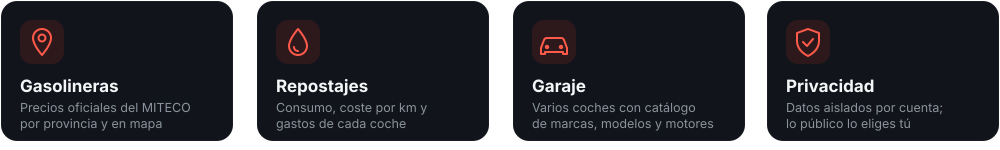

 

 

 

**[fuelapp.es](https://fuelapp.es)** compara el precio de la gasolina y el diésel en más de 11.000 gasolineras de España con datos oficiales del Ministerio (MITECO), y sirve también para llevar los gastos de tu coche.

 

 

 

 

  

 

  

  

 

