

 


 

<a href="https://fuelapp.es">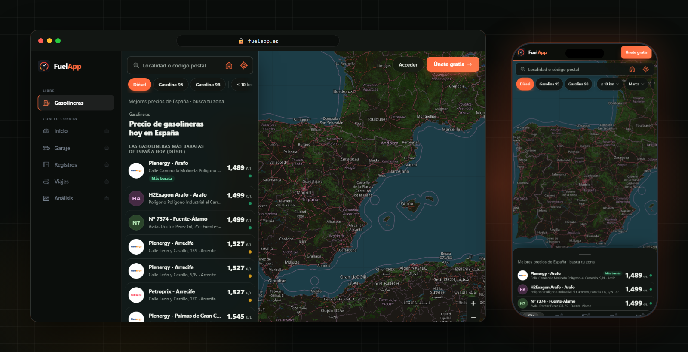</a>

 

<table>
<tr>
<td width="64"><a href="https://fuelapp.es">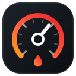</a></td>
<td>
<b><a href="https://fuelapp.es">fuelapp.es</a></b> compara el precio de la gasolina y el diésel en más de 11.000 gasolineras de España con datos oficiales del Ministerio (MITECO), y sirve también para llevar los gastos de tu coche.
</td>
</tr>
</table>

<a href="https://fuelapp.es/gasolineras">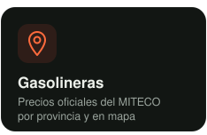</a>
<a href="https://fuelapp.es/acceso?s=registros">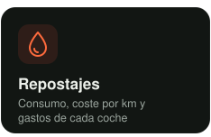</a>
<a href="https://fuelapp.es/acceso?s=garaje">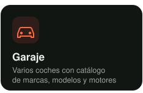</a>
<a href="https://fuelapp.es/aviso-legal">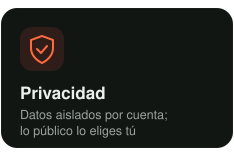</a>

 

  

 


 

<a href="https://github.com/yery27/mis-skills"></a>

 

  

 

  

  

 

<a href="https://fuelapp.es"></a>

