 

---

## 👋 Sobre mí

- 🛡️ Ciberseguridad, hacking ético y entender cómo se rompen (y se arreglan) las cosas
- 🖥️ Redes, protocolos y administración de servidores
- 🌐 Desarrollo web con PHP, JavaScript y Python
- 📍 Catalunya

---

## ⛽ FuelApp

**[fuelapp.es](https://fuelapp.es)** compara el precio de la gasolina y el diésel en más de 11.000 gasolineras de España con datos oficiales del Ministerio (MITECO), y además sirve para llevar los gastos de tu coche.

| | |
|---|---|
| 🗺️ **Gasolineras** | Precios por provincia, localidad y mapa, actualizados cada día |
| ⛽ **Repostajes y gastos** | Consumo, coste por km y gastos extra por vehículo |
| 🔧 **Mantenimiento y documentos** | Revisiones y documentos protegidos por cuenta |
| 🚗 **Garaje** | Varios vehículos, con catálogo de marcas, modelos y motores autocompletado |
| 📊 **Estadísticas** | TCO, rutas y calculadora de costes |
| 🔒 **Privacidad** | Datos aislados por cuenta; lo público lo eliges tú |

 

---

## 🚀 Más proyectos

<table width="100%">
  <tr>
    <td align="center">
      
      <h3>🧠 Mis Skills</h3>
      Mi colección de skills para IA
        
      
        
      <a href="https://github.com/yery27/mis-skills"><b>Ver repo →</b></a>
    </td>
  </tr>
</table>

---

## 🧰 Stack

---

## 📊 Stats

 

